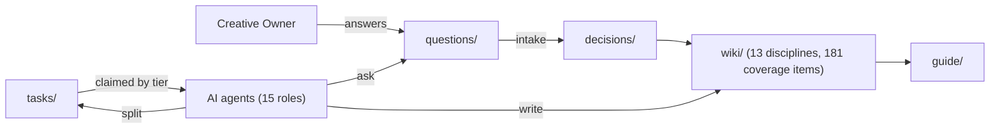
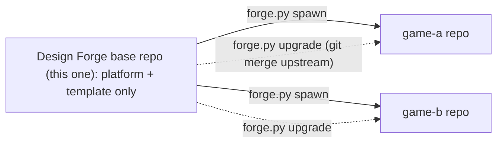

# Design Forge

A reusable platform for building a **game design bible** with a simulated team of
AI agents, inspired by the design documents classic studios worked from.

You (the **Creative Owner**) hold the vision. AI agents, each playing a studio role
(Creative Director, Systems Designer, Art Director, QA Lead…), **interview you**,
turn your answers into **locked decisions**, and write a wiki complete enough to
build the game *and* write its player guide.

- Agents start at **[AGENTS.md](AGENTS.md)**.
- The rules are in **[platform/](platform/)**: [philosophy](platform/PHILOSOPHY.md),
  [workflow](platform/WORKFLOW.md), [capability tiers](platform/CAPABILITIES.md),
  [protocols](platform/protocols/), [team roster](platform/roles/README.md).
- Each game lives in `projects/<slug>/`.

## How it works



1. **Seed:** you pitch the game in a paragraph.
2. **Discovery:** agents grill you on vision, scope, market, and tech.
3. **Decomposition:** every discipline's **coverage map** (the checklist of
   essentials a top-tier game needs answered) becomes tasks, tagged by the model
   tier able to handle them.
4. **Design:** agents claim tasks they're capable of, send you batched,
   multiple-choice questions with recommendations, and lock your answers.
5. **Validation:** a Reviewer, QA Lead, and Guide Writer hunt for gaps and
   contradictions.
6. **Guide & handoff:** locked player-facing pages compile into a guide; the
   Producer writes a build roadmap.

## Quick start

```bash
# 1. From this (clean base) repo, spawn a separate repo for a new game
python3 tools/forge.py spawn ../my-game my-game "My Game"
cd ../my-game

# 2. Open any AI agent in the game folder and say:
#    "Read AGENTS.md. You are the Orchestrator (tier T1). Run the Seed Interview for projects/my-game."

# 3. Later, spin up more agents, one per role, e.g.:
#    "Read AGENTS.md. You are the Systems Designer, tier T2, caps [code]. Work on projects/my-game."

# 4. Answer questions whenever you like:
#    open projects/my-game/BOARD.md → "Waiting on the Creative Owner"
```

## Multiple products: keeping the base clean



- **This repo is the clean base.** It holds only `platform/`, `tools/`, and
  `projects/_template/`. `forge.py new` refuses to create games here (`--force`
  exists for quick testing; delete test projects afterwards).
- **Each game gets its own repo**, created by `forge.py spawn`. It is a clone of
  the base with the base set as the `upstream` remote, plus a `.forge-game` marker.
  Games stay private and independent, and each has its own history.
- **Improving the platform:** make the change *in the base*, bump
  [platform/VERSION](platform/VERSION), add a [CHANGELOG](CHANGELOG.md) entry, commit.
- **Updating a game:** in the game repo run `python3 tools/forge.py upgrade`.
  It merges the new platform from `upstream`, then runs `sync`, which adds any new
  template files and coverage rows to existing projects **without touching their
  content**, and stamps `platform_version` in `PROJECT.md`.
- **Golden rule:** games never edit `platform/`, `tools/` or `projects/_template/`.
  Because games only *add* `projects/<slug>/`, upgrades merge without conflicts.
- If you push the base to GitHub, point games at it:
  `git remote set-url upstream <github-url>` (or `spawn --source <url>`).
  You can also mark the GitHub repo as a *template repository*, but keep the
  `upstream` remote so upgrades still work.

### Answering questions
Open a file in `projects/<slug>/questions/open/`, write your answer under each
**Your answer** (a letter, free text, or "your call"), and set `status: answered`.
Or just answer in chat, and the agent will transcribe your words verbatim.

## CLI reference (`tools/forge.py`, Python 3.8+, no dependencies)

| Command | Purpose |
|---|---|
| `spawn <dir> <slug> "<Name>"` | *(base)* Create a new game repo with the base as `upstream` |
| `upgrade` | *(game)* Merge the latest platform from `upstream`, then `sync` |
| `sync [<slug>]` | Add new template files / coverage rows to existing projects |
| `new <slug> "<Name>"` | Create a project from `projects/_template/` (game repos) |
| `list` | List projects and phases |
| `board <slug>` | Regenerate the `BOARD.md` dashboard |
| `next <slug> --tier T2 [--caps web,code] [--role r]` | Show tasks this agent may claim |
| `claim <slug> <ID> --agent X --tier T2 --role r` | Claim a task (enforces tier/caps/deps/phase) |
| `id <slug> task\|question\|decision <CODE>` | Next free ID for a role code |
| `create <slug> task\|question\|decision <CODE> "<title>"` | Create a file from template |
| `decompose <slug> [--max-phase N] [--discipline d]` | Turn coverage rows into tasks |
| `validate [<slug>]` | Check frontmatter, links, traceability, banned hedge words |
| `guide <slug>` | Compile locked `guide: true` pages into `guide/_compiled.md` |

## Viewing the wiki
Everything is plain Markdown with YAML frontmatter and Mermaid diagrams. Open the
folder in **Obsidian**, VS Code, or GitHub, or add MkDocs later if you want a
website. Use **git** so every claim, answer and decision is versioned.

## Customising the platform
- **New coverage items for all future games:** edit
  `projects/_template/wiki/<discipline>/index.md`.
- **New role:** add `platform/roles/<role>.md`, register its code in
  `platform/roles/README.md` and in `ROLES` in `tools/forge.py`.
- **New models:** update the examples column in `platform/CAPABILITIES.md`.
