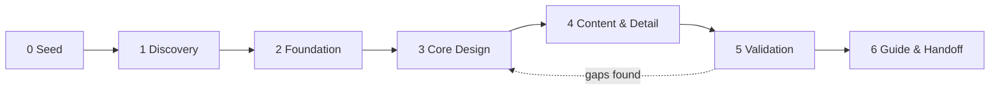
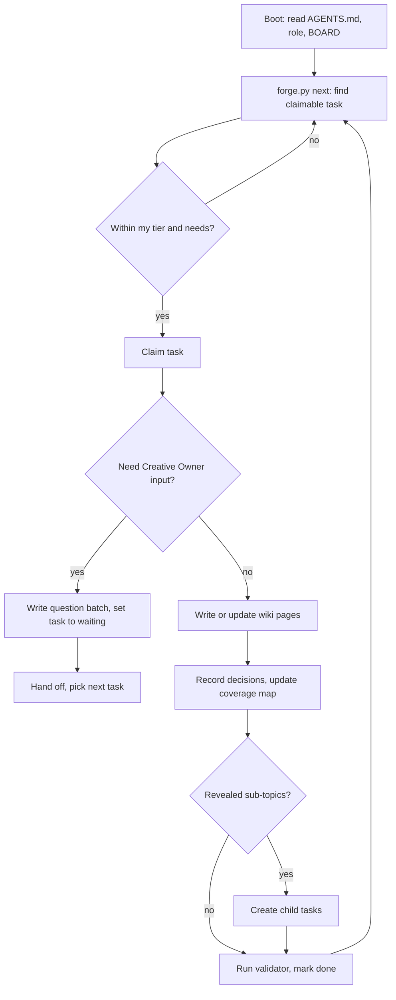

# Workflow — From Seed to Guide

A project's current phase is stored in `projects/<slug>/PROJECT.md` (`phase:`).
Only the **Orchestrator** advances the phase, and only when that phase's exit
criteria are met.

## Phase 0 — Seed
**Goal:** capture the idea in the Creative Owner's own words.
- From the clean base, run `python3 tools/forge.py spawn ../<slug> <slug> "<Game Name>"`
  (creates a separate game repo; see README "Multiple products").
- The Orchestrator interviews the Creative Owner using the **Seed Interview**
  (in [roles/orchestrator.md](roles/orchestrator.md)) and fills in `PROJECT.md`.
- **Exit:** `PROJECT.md` has a seed paragraph, working title, Creative Owner
  preferences (how many questions per batch, how often), and known hard constraints.

## Phase 1 — Discovery (the "grill")
**Goal:** work out *what kind of game this is* before designing anything.
- Creative Director: pillars, fantasy, tone, audience, reference games, anti-goals.
- Producer: scope, team, budget, timeline, target platforms.
- Business Strategist: market position, genre, business model at a high level.
- Technical Director: engine and platform constraints.
- **Exit:** `wiki/00-vision/` pillars + fantasy + audience are `locked`;
  `wiki/10-production/` scope + platforms are `locked`.

## Phase 2 — Foundation (decomposition)
**Goal:** turn the vision into a complete backlog.
- The Orchestrator reads every discipline's coverage map and creates a
  **discovery task** for each unresolved item, in dependency order.
- Each discipline lead (role) reviews its map, **adds** missing items specific to
  this game, and proposes `n/a` items (via question → decision).
- **Exit:** every coverage item in every discipline has either a task or an `n/a`
  decision. The backlog is complete for the current depth.

## Phase 3 — Core Design
**Goal:** lock the core loop and everything it directly touches.
- Systems (core loop, controls, verbs, rules), Narrative (premise, world), Art
  (style), Audio (direction), UX (HUD, onboarding philosophy), Tech (architecture).
- Tasks recursively split: when a task's answer reveals sub-topics, the agent
  creates child tasks (see [protocols/TASKS.md](protocols/TASKS.md#splitting)).
- **Exit:** core loop, controls, primary systems, art style, narrative premise
  are `locked`. Reviewer has run a consistency pass.

## Phase 4 — Content & Detail
**Goal:** fill in every specific: levels, enemies, items, numbers, dialogue rules,
asset lists, economy tables, monetisation details.
- **Exit:** every coverage item is `locked` or `n/a`. `forge.py board` shows 100%.

## Phase 5 — Validation
**Goal:** prove the wiki is buildable and coherent.
- Reviewer: full consistency & traceability audit.
- QA Lead: test plan written against locked specs; flags any untestable rule.
- Guide Writer: dry-run of the guide outline; every gap becomes a task.
- Gaps send work back to Phase 3/4. Loop until clean.
- **Exit:** validator passes with zero errors; Reviewer signs off in `PROJECT.md`.

## Phase 6 — Guide & Handoff
**Goal:** produce deliverables.
- `forge.py guide <slug>` assembles all `guide: true` locked pages.
- Guide Writer edits it into a player-facing guide in `guide/`.
- Producer writes the build roadmap (milestones → epics → implementation tasks)
  for whatever team (human or AI) builds the game.

## The core loop of every agent

## How answers flow back
1. Creative Owner answers in `questions/open/Q-*.md` (or in chat; an agent then
   transcribes the answers verbatim into the file).
2. Any agent with role access runs the **answer intake** procedure
   ([protocols/QUESTIONS.md](protocols/QUESTIONS.md#intake)): creates decision
   records, moves the file to `questions/answered/`, flips waiting tasks back to `open`.
3. The original task owner (or any qualified agent) resumes the task.
