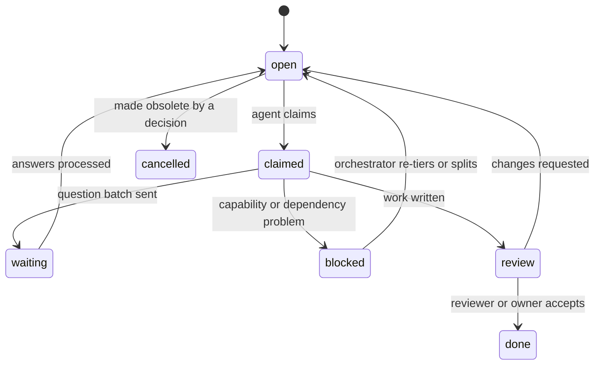

# Task Protocol

Tasks are files in `projects/<slug>/tasks/`, named `<ID>.md` (e.g. `T-SYS-0004.md`).
The frontmatter is the state; the body is the brief and the log.

## Task IDs
`T-<ROLECODE>-<NNNN>`. Role codes are listed in [roles/README.md](../roles/README.md).
Get the next free ID with `python3 tools/forge.py id <slug> task <ROLECODE>`.
Per-role numbering means parallel agents never collide.

## Frontmatter (all fields required; use empty values if not applicable)

```yaml
---
id: T-SYS-0004
title: Define the core gameplay loop
role: systems-designer        # owning role (file name in platform/roles/)
status: open                  # see lifecycle below
tier: T1                      # minimum tier: T1 | T2 | T3
needs: [human]                # capability flags, see CAPABILITIES.md
phase: 3                      # workflow phase this belongs to
priority: high                # blocking | high | normal | low
depends_on: [T-CD-0002]       # tasks that must be `done` first
parent:                       # parent task ID if this was split off
coverage: 01-mechanics/core-loop   # <discipline folder>/<coverage key>
claimed_by:                   # "<agent> <tier> <role> <ISO time>"
questions: []                 # Q-* batches raised by this task
outputs: []                   # files created/changed
---
```

## Lifecycle



## Claiming
A task is **claimable** when:
1. `status: open`, and
2. every ID in `depends_on` is `done`, and
3. your tier ≥ `tier`, and you have every flag in `needs` (except `human`: tasks
   needing `human` are claimable; your job is to prepare the human's part), and
4. your role matches `role` — **or** the task is T3 housekeeping (any role may take it).

To claim: set `status: claimed`, fill `claimed_by`, append a log line. Or run
`python3 tools/forge.py claim <slug> <ID> --agent "<name>" --tier T2 --role <role>`.
If the repo is under git, commit the claim immediately so others see it.

**One task at a time.** Finish, block, or release a task before claiming another.

**Stale claims:** a `claimed` task with no log entry for 24h may be reset to `open`
by the Orchestrator.

## Doing the task
1. Read the `## Context` links first. Never skip this.
2. Decide: can it be completed from **locked** information alone?
   - **Yes** → write/update the wiki pages, following [WRITING.md](WRITING.md).
   - **No** → write a question batch ([QUESTIONS.md](QUESTIONS.md)), add its ID to
     `questions:`, set `status: waiting`. Stop and pick another task.
3. When answers return, record decisions ([DECISIONS.md](DECISIONS.md)), then write pages.
4. Update the discipline's **coverage map** row (status, page, decision).
5. Run `python3 tools/forge.py validate <slug>`; fix all errors you caused.
6. Set `status: review` (or `done` for T3 housekeeping), list `outputs`, write the log.

## Splitting
If a task is too large for a handful of questions, or the answers reveal new
sub-topics, **split it**:
- Create child tasks with `parent: <this ID>`, each with its own tier/needs.
  Tier them honestly: tasks within one locked framework are often T2/T3.
- Add new coverage rows to the discipline `index.md` for genuinely new topics.
- The parent becomes `done` only once all children are `done`.

A good leaf task can be finished in **one session** and needs at most **one
question batch**.

## Body template
See [templates/task.md](../templates/task.md). Sections: `## Objective`,
`## Context (read first)`, `## Acceptance criteria`, `## Log`.

## Log format
Append-only. Newest at the bottom.
```
- 2026-11-03T19:40Z | agent: Claude Sonnet  tier: T2  caps: [code]  role: systems-designer | claimed
- 2026-11-03T19:55Z | ... | raised Q-SYS-0002 (5 questions), status → waiting
```
